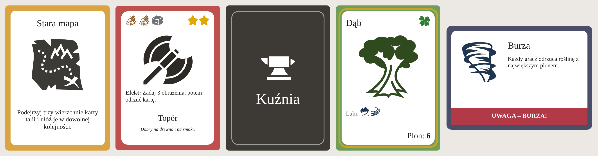

# Generator kart

**[⬇️ Pobierz aplikację na Maca](https://github.com/DarkenPL/GeneratorKart/releases/latest/download/Generator-kart.dmg)** – najnowsza wersja, Mac z procesorem Apple (M1–M4) · [instalacja i pierwsze uruchomienie](docs/aplikacja.md)

Generator kart do gier planszowych i karcianych. Karty trzymasz w arkuszu (CSV albo XLSX), wygląd opisujesz prostym plikiem tekstowym w stylu [nanDecka](https://www.nandeck.com/), a aplikacja na bieżąco pokazuje gotowe karty. Z aplikacji możesz:

- **zapisać PDF do druku**: A4 ze znacznikami cięcia (karty 1:1, np. 63×88 mm) i z rewersami do druku dwustronnego, albo każda karta na osobnej stronie;
- **wyeksportować obrazki JPG** każdej karty do folderu `Export` projektu;
- **wgrać karty do pokoju [playingcards.io](https://playingcards.io)**, podmieniając talie w istniejącym stole.



## Szybki start

1. [Pobierz aplikację](https://github.com/DarkenPL/GeneratorKart/releases/latest/download/Generator-kart.dmg), otwórz pobrany plik i w okienku przeciągnij **Generator kart** na folder **Programy**.
2. Za pierwszym razem kliknij ją **prawym przyciskiem → Otwórz**. Aplikacja nie ma podpisu Apple, więc trzeba ją raz odblokować ([szczegóły](docs/aplikacja.md)).
3. Na ekranie powitalnym wybierz **Nowy projekt…** (powstanie folder gry z gotowym szablonem, plikiem kart i ikonami), jeden z **przykładów** albo **Otwórz szablon…** swojej gry.

Karty odświeżają się same po każdym zapisie szablonu albo pliku z kartami. Szablon możesz edytować we wbudowanym **edytorze** (przycisk **Edytor**, ⌥⌘E), z kolorowaniem składni, zaznaczaniem błędów i podglądem kart na żywo.

## Projekt gry

Projekt otwierasz, wskazując **plik szablonu** (`.txt`). Szablon mówi, skąd wziąć karty i obrazki. Ścieżki w szablonie liczą się od folderu projektu, czyli folderu, w którym leży szablon. Gdy szablon leży w podfolderze `Szablony`, folderem projektu jest folder nad nim.

```
moja-gra/
├── karty.csv                   dane kart – jeden wiersz = jedna karta
├── ikony.csv                   znaczniki ikon, np. {drewno} → Ikony/drewno.svg
├── Ikony/, Art/                obrazki
├── Szablony/
│   └── gra.txt                 wygląd kart – ten plik otwierasz w aplikacji
└── Export/                     obrazki JPG z eksportu (tworzy aplikacja)
```

**`karty.csv`**

```
ID;Ilość;Nazwa;Rodzaj;Koszt;Efekt
1;3;Miecz;broń;{drewno}{zloto};Zadaj 2 obrażenia.
```

**`Szablony/gra.txt`**

```
NAZWA = Przedmioty
DANE  = karty.csv
KARTA = 63, 88

KOLOR = broń, #C0504D

TŁO       = [Rodzaj]
PROSTOKĄT = 3.5, 3.5, 56, 81, kolor=#ffffff, zaokrąglenie=4
TEKST     = 6, 5.5, 51, 9, [Koszt], ikony=1.8
TEKST     = 6, 64, 51, 9, [Nazwa], rozmiar=14, wyrównanie=środek
TEKST     = 6, 51, 51, 12, "**Efekt:** [Efekt]"
```

Wymiary są w milimetrach, `[Kolumna]` wstawia wartość z arkusza, a `{znacznik}` wstawia ikonę. Za długi tekst zmniejsza się sam. Jeden szablon może opisywać kilka talii (sekcje `[TALIA …]`).

## Przykłady

Są wbudowane w aplikację (menu **Plik → Przykłady**), a ich pliki leżą w repozytorium:

| Projekt | Co pokazuje |
|---|---|
| [`01-wyprawa`](przyklady/01-wyprawa) | najprostsza talia: kolor z kolumny, tytuł, obrazek, opis |
| [`02-kuznia`](przyklady/02-kuznia) | ikony w tekście, koszt i punkty w jednym wierszu (`grupa=`), pole znikające przy pustej kolumnie, rewers |
| [`03-ogrod`](przyklady/03-ogrod) | dwie talie w jednym pliku, karta pozioma, warunki `jeśli=`, wspólna paleta kolorów |

## Dokumentacja

- [Aplikacja: instalacja, skróty, wydania](docs/aplikacja.md)
- [Komendy szablonów](docs/komendy.md) – pełna lista
- [Nowa talia krok po kroku](docs/nowa-talia.md)
- [Eksport do playingcards.io](docs/playingcards.md)

## Licencje

Ikony w przykładach pochodzą z [game-icons.net](https://game-icons.net) (CC BY 3.0). Autorzy, a także licencje czcionek i bibliotek dołączonych do aplikacji, są wymienieni w [CREDITS.md](CREDITS.md).
